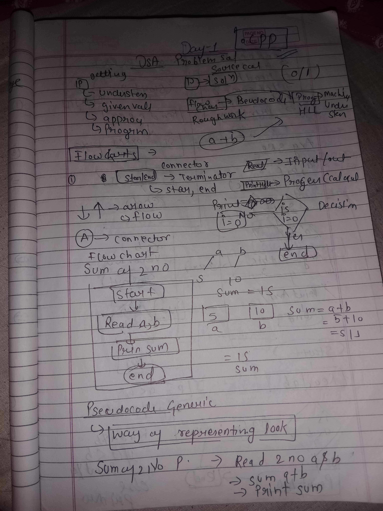

# Day001 Introduction, Flow Charts, PseudoCode, Programming and Why

## 📘 Flowchart Notes

---

### 🧩 FlowChart
It is a visual representation of a program using diagrams and shapes having a fixed meaning.  
**Example:** In a flow chart, the *ellipse* denotes the start and end of the program.  

- **Parallelogram** → Input or output statement  
- **Rectangle** → Calculation or arithmetic operations  
- **Rhombus** → Decision or comparison  

**Note:** There is no symbol or shape for loops, but the decision shape can be used to make a loop.

---

### 💡 PseudoCode
It is a general instruction without any syntax, but once written, it can be easily converted into code.

---

### 💻 Programming
Programming languages are special languages that can be converted into computer‑understandable format written in a fixed syntax.  
A computer performs calculations and actions better than humans, but it only understands 0 and 1.  
Hence, we write programs in human‑understandable format, and a **compiler** converts them into machine code.
